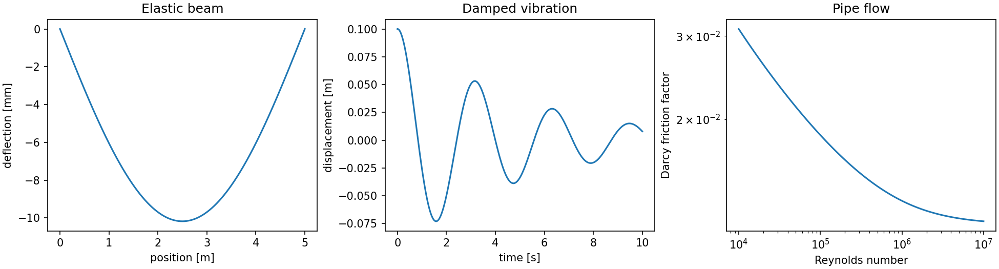

engineeringkit
==============

.. include:: /_generated/vars.rst

**engineeringkit** makes the models behind |num_subpackages| engineering domains
computable, inspectable and visualizable. Choose a domain to find its foundational
ideas, runnable examples and full API in one place. NumPy and SciPy provide mature
numerical solvers; EngineeringKit exposes engineering equations, SI conventions
and intermediate results for learning and teaching.

Browse by domain
----------------

.. include:: /_generated/grid_hub.rst

Start here
----------

:doc:`quickstart` explains installation and basic use. The domain guides describe
units, sign conventions and model assumptions; :doc:`validation` records the
benchmark policy, and :doc:`limitations` identifies remaining scope limits.
Version 0.1.0 includes all twelve domains and enforces 100% production statement
coverage. That metric does not prove scientific correctness or model applicability.

.. code-block:: python

   from engineeringkit.structural_engineering import SimplySupportedBeam
   beam = SimplySupportedBeam(5, 200e9, 8e-6)
   result = beam.solve_point_load(10000)
   print(result.summary())
   fig, axes = result.plot()

.. toctree::
   :maxdepth: 2
   :caption: Subpackages
   :hidden:

   subpackages/index

.. toctree::
   :maxdepth: 2
   :caption: History
   :hidden:

   history/index

.. toctree::
   :maxdepth: 2
   :caption: Examples
   :hidden:

   examples/index

.. toctree::
   :maxdepth: 2
   :caption: API
   :hidden:

   api/index

